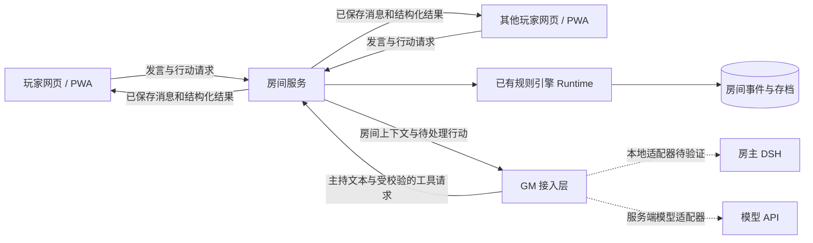

# 多人联机平台与房间同步方案

状态：2026-10-27 建议稿，供用户验收；尚未实现联网房间。本方案处理平台、消息、角色数值与存档同步，不修改战斗平衡。

## 1. 推荐形态

优先开发响应式网页玩家端、统一房间服务和一个可替换的 AI GM 接入层。玩家通过邀请链接进入房间，电脑和手机共用同一套界面；后续增加 PWA 安装入口，需要独立桌面客户端时复用相同服务和页面。

房主可继续使用本地 DSH 作为主持/调试入口。玩家无需安装 DSH，不共用房主的 DSH 账号或原始会话管理页面。房间服务持有唯一有效游戏状态，负责鉴权、行动排队、规则结算、持久化和广播。

网页版与应用版都需要这套同步服务；单纯封装桌面窗口不能解决重复扣血、状态冲突或断线恢复。当前项目以文本、检定和角色面板为核心，网页适合作为第一版交付形态。

PWA 可在支持的浏览器中安装，并以独立窗口启动；平台支持有差异，仍保留浏览器入口。参考：[MDN：PWA 安装](https://developer.mozilla.org/en-US/docs/Web/Progressive_web_apps/Guides/Making_PWAs_installable)。

## 2. 玩家使用流程

1. 房主创建房间，选择新多人档或导入符合多人规则的存档，配置 GM 来源，发出邀请链接。
2. 玩家进入房间，建立自己的成员身份并绑定一个角色；邀请码用于邀请，实际操作通过个人会话鉴权。
3. 玩家自由输入角色行动、对白或场外讨论。GM 与系统结算信息以不同样式呈现。
4. 需要检定时，指定玩家收到骰卡；提交后所有获准观看的成员看到同一组真实骰面和结算结果。
5. 房主保存进度时记录剧情说明、人物状态和聊天边界；恢复时建立新的共同分支，所有在线成员切换并获知恢复位置。

界面以共同叙事为中心，侧边按需展开人物卡、队伍、任务、地图和骰子记录。故事行动保持自由输入；按钮承担掷骰、查看资料、管理成员和保存等操作，不预设剧情选择菜单。

## 3. 服务关系

首版可由一个 Node.js 服务承载房间、连接和引擎调度，不提前拆成多个微服务。每个房间有独立队列和最多一个正在执行的 GM 任务；不同房间可并行。

## 4. 房间同步的基本规则

### 4.1 客户端提交意图，服务端给出结果

玩家发送“林川攻击丘丘射手”及对应行动参数，不能直接提交“目标HP改为0”。服务端从已登录身份找到其绑定角色，检查回合、目标、库存、能力与权限，运行规则引擎，提交成功后广播实际结果。

前端可立即显示“已提交/等待处理”，HP、物品消耗和骰点等事实只根据服务端确认更新。刷新、重发或断线重连不重新计算已完成检定。

### 4.2 两种序号和一个分支标识

| 字段 | 用途 |
|---|---|
| `eventSeq` | 房间消息及系统事件的时间顺序，用于补收断线期间的信息 |
| `stateRevision` | 游戏状态版本，仅在实际状态变化时递增，用于拒绝过期行动 |
| `branchId` | 当前存档分支；读档后拒绝旧分支仍在网络上的提交和GM回调 |

普通聊天只增加事件序号，不因一条闲聊就使正在等待的骰卡失效。角色状态、回合等变化可能使待判定行动失效，须明确提示原因，不能悄悄重掷。

### 4.3 排队、幂等与短事务

每个写操作携带唯一 `commandId`、`branchId` 和相应 `expectedRevision`。身份与角色归属由服务端会话确认。同一成员用相同编号重复发送相同请求，只返回首次结果；相同编号换参数则拒绝。

状态改变、对应结果事件、已执行命令和待处理状态在一次短事务中保存。数据库提交成功后才广播；广播前崩溃也能在重连后补发。AI生成期间不长期占着数据库事务。

GM一轮可能含多个工具调用，每个调用独立记录执行结果和恢复位置。中断后从最后已提交步骤恢复，不从头重复扣资源、发奖励或掷骰。流式文本标记为生成中，不能在数值提交前把伤害和胜负写成既成事实。

### 4.4 断线与恢复

客户端重连发送自己持有的 `branchId` 和最后收到的 `eventSeq`。服务端按成员权限补发缺失事件；历史缺口过大或分支不同则发送当前可见快照和新的消息位置。

离线期间允许保存输入草稿，重连后由玩家确认提交。过期攻击、物品使用和骰卡不自动排队重放。玩家掉线不会立即变成退队、昏迷或交由AI操控，超时处理按开团约定执行。

## 5. 多人发言与 AI GM 调度

日常对话允许所有玩家说话。消息包含发言者、角色和频道，场外讨论不自动当作游戏行动。只确认另一人的对白不会无故推动一天或整个场景。

GM生成期间的新行动进入可见队列。GM按已确认的现场顺序处理相关行动；涉及相互矛盾的动作时澄清先后，而不是并行生成两段互不一致的现实。不因每条聊天消息都触发一轮模型调用。

战斗行动由现有先攻和当前行动者校验。其他玩家可以说话或提出战术建议，但不能替当前角色消费资源或提前攻击。

房间任务持久化记录 `jobId`、状态版本、处理到的消息位置、工具执行位置和当前分支。一个房间只允许一个有效GM任务；多服务进程部署时还须有数据库租约/锁校验，不能只依赖进程内队列。

## 6. 掷骰、角色卡和信息权限

骰卡必须持久化到房间，记录指定玩家、行动者、目的、难度、修正、风险、待使用资源及状态版本。默认只有指定玩家提交；代掷需要明确授权并留痕。浏览器关闭后重新进入仍能看到有效的待检定。

服务端产生随机骰面并结算，客户端播放同一个 `rollId` 的结果动画。动画结束时间不决定伤害和回合。实物骰输入只有房间事先启用时才开放，并标注来源。

按身份构造可见快照和事件：公共剧情与公开检定给全房间；私聊给指定接收者；个人秘密按设定给本人和GM；GM隐藏资料留在服务端。使用字段白名单构造玩家数据，不向浏览器发送完整内部存档后再用界面隐藏。

房主权限管理成员、保存、结束会话和发起恢复；玩家只操作已绑定角色。房主管理权与角色知情范围分开表示。自托管机器的管理员可接触后端文件，不能将其等同普通玩家的前端权限隔离。

## 7. 保存、读档和规则版本

服务器自动保存每次已提交变化。主动保存为已有事件位置增加名称、剧情说明和规则版本，不依赖某位玩家浏览器的缓存。

保存点记录：游戏快照、状态版本、已发布聊天边界、队伍、规则/资料版本，以及是否处于GM生成或等待骰子状态。第一版只允许在GM空闲且无未决数值动作时建立可恢复保存点；处理中按保存则排队到下一个稳定位置并告知，不能静默少存一段。

房主恢复进度时，先暂停新的行动并取消旧GM任务，建立新 `branchId`，让快照和对话同时切换，再允许继续。原分支保留可查；不能仅改房主自己的角色卡，也不能把旧对话仍作为新分支的实际历史。

房间固定运行时规则版本，不能因为另一台玩家电脑升级插件而改变数值。旧本地档导入前核对格式、多人角色数量和规则版本，先复制为新房间，保留来源；单人档不自动转换成多人档。

## 8. 数据存储和部署

第一版建议 SQLite + 单服务进程，用事务保存房间、成员、命令、游戏事件、聊天、快照、保存点与GM任务。SQLite文件留在服务端；多人联网通过服务访问，不共享数据库文件或用同步盘同步存档。

SQLite WAL允许读写并行，但同一时间只有一个写入者，适用于首版短事务方案；它不支持通过网络文件系统共享WAL。参考：[SQLite WAL 文档](https://www.sqlite.org/wal.html)。

公开多房间运行后，根据实测的数据库写入等待、队列延迟和多实例需求迁移 PostgreSQL。协议、房间权限和引擎接口保持独立，不要求首版配置Redis或消息集群。

| 部署方式 | 使用方式 | 限制与适用场景 |
|---|---|---|
| 房主自托管 | 房主启动服务，玩家通过同一局域网或配置好的外网访问入口加入 | 适合熟人首测；服务依赖房主机器运行，退出游戏网页不等于关闭服务 |
| 云端房间服务 | 统一HTTPS域名，玩家邀请入房 | 适合面向更多玩家；服务端管理数据库、会话与备份 |
| 后续桌面客户端 | 包装同一玩家端及可选本地主持功能 | 复用同一房间协议；无需再做一套数值和存档实现 |

网络连接使用HTTPS/WSS。邀请链接、个人会话和GM接入令牌分别校验，不能将当前本地试玩的共享连接令牌作为公共多人权限方案。模型凭据保存在房主本机或服务端GM配置中，不发给普通玩家浏览器。

WebSocket用于实时事件、骰子和在线状态广播；历史/快照可用HTTP获取。参考：[MDN WebSocket](https://developer.mozilla.org/en-US/docs/Web/API/WebSocket)。

## 9. 对现有项目的复用与改造

| 当前内容 | 可复用部分 | 联机需要增加的部分 |
|---|---|---|
| `engine/runtime.js`及战斗/人物模块 | 行动校验、HP、库存、先攻、效果与规则解析 | 可信房间命令入口、成员到角色映射、固定规则版本 |
| `engine/journal.js` | 只追加事件、版本校验、请求幂等、快照恢复的设计 | 多人持久化适配器；禁止房间服务与DSH各自维护一份权威状态 |
| `engine/checkpoints.js` | 复制分支和保留原档的语义 | 联机消息边界、分支切换通知、旧任务和骰卡作废 |
| `server/app.js`、`server/index.js` | Node服务和规则调用的基础组织 | 房间/会话鉴权、实时连接、用户权限；当前仅绑定127.0.0.1并校验本机Host |
| `lib/client.js` | 地图入口、骰卡和保存交互经验 | 面向玩家的房间界面；现有模块依赖DSH宿主，不能直接当作独立网页复用 |
| GM提示词和资料 | 主持规范、地区/人物与主线知识 | 多人发言身份、私有信息投影和房间GM任务管理 |

现有文件锁能避免同一槽位并行提交，`requestId`与`expectedRevision`已有复用价值，但它们没有提供用户身份、房间成员权限、网络事件补发和GM队列。

DSH桥接须先做独立能力验证：是否能稳定接收外部房间消息、流式返回主持输出、执行房间工具、恢复中断任务。现有聊天分支/恢复接口不证明具备这些能力。若验证可行，以可信适配器把DSH工具写入转发给房间服务；不再同时写本地同名槽位。若接入能力不足，则使用服务端模型API适配器，并保留本地DSH作为独立单机模式。最终采用哪条GM接入路径需验证后确定。

## 10. 实施顺序与首版验收

1. 建立房间服务和基础网页：创建/加入、成员身份、绑定角色、公共聊天、结构化状态广播；先用确定的测试主持输出验证联网。
2. 接入真实规则引擎：攻击、消耗、回合、指定玩家骰卡、重复提交保护、断线补发和信息权限。
3. 验证并接入一个GM适配器，实现单房间GM队列与中断恢复，开始真实多人剧情测试。
4. 加入稳定位置保存、整房间读取分支和旧档导入；再补PWA安装、界面打磨与公开部署。

首版验收必须在多个独立浏览器会话中进行，不能只开同一个用户的两个标签页：

- A掷骰后，B、C看到相同骰面、伤害与HP；重复点按或重发请求只扣一次。
- A不能操作B角色，也不能从快照、历史或实时事件读取GM隐藏资料。
- 攻击与使用道具同时提交时，服务端给出确定顺序，不产生负库存或额外行动。
- 刷新/断网后恢复到相同状态，待骰卡仍正确；丢失的GM广播可补收。
- GM工具执行后进程中断，恢复时不重掷、不重复奖励；玩家聊天不会启动第二个GM。
- 读取保存点后所有人进入同一分支，旧页面提交、旧骰卡和旧GM回调均无法写入。
- 两个独立房间不会互相收到消息、角色数据或保存点。

以上为实施和验收要求，目前未创建联网服务、部署站点或执行多人测试。
